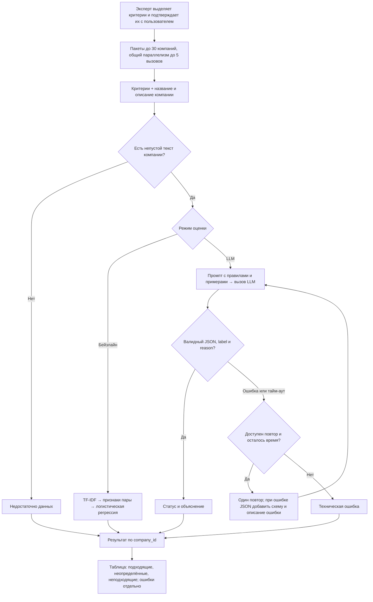
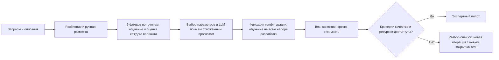

# ML System Design: оценка релевантности компаний в DealRocket

**Автор:** Александр Сафронов. **Итерация:** MVP. **Статус:** проектирование.

## 1. Цели и предпосылки

### 1.1. Зачем идём в разработку продукта

DealRocket помогает находить компании и контакты для B2B-продаж.
Отраслевые фильтры дают широкую выдачу: в строительстве встречаются подрядчики,
застройщики и продавцы материалов. В ручном сценарии менеджер читает описания
и отбирает компании под свой запрос.

Система автоматизирует эту проверку. Для каждой компании она определяет
соответствие запросу и объясняет решение. ML нужен для сопоставления формулировок:
«строительство коттеджей» и «возведение индивидуальных жилых домов» описывают
близкую деятельность без точного совпадения слов.

В DealRocket уже используется AI-фильтр с тремя статусами. На момент проектирования
для эксперимента не предоставлены его ответы, размеченный эталон и результаты
измерения качества. Поэтому эффективность действующего фильтра не подтверждена
в рамках проекта. Проект создаёт эталон, воспроизводимую оценку и отдельный
классификатор. Ручной отбор служит бизнес-контролем для проверки пользы автоматизации.
В MVP сравниваются текстовый бейзлайн и LLM; замена действующего фильтра
и сравнение с ним относятся к этапу внедрения.

**Бизнес-цель:** сократить медианное время отбора по согласованным критериям
на 20% относительно ручной работы, допустив снижение precision и recall
не более чем на 5 п.п.
Исходное время и качество ручного отбора измеряются в контрольном условии пилота:
на тех же 20 списках по 15 компаний, что и отбор с системой. Численные результаты
и распределение классов вносятся в отчёт эксперимента.

### 1.2. Бизнес-требования и ограничения

| Требование | Реализация в MVP |
| --- | --- |
| Оценивать компании по запросу | Вход: критерии поиска, названия и описания компаний |
| Разделять несоответствие и нехватку сведений | Три класса: «подходит», «не подходит», «недостаточно данных» |
| Объяснять решение | LLM возвращает краткое обоснование по исходному тексту |
| Сохранять контроль пользователя | Подходящие записи — первыми, неопределённые — следом, неподходящие — внизу; все доступны для просмотра |
| Обрабатывать сбои | Показывать ошибку отдельно от оценки релевантности и сохранять запись для ручной проверки |

Плановый лимит расходов на LLM для MVP — 3000 ₽: выбор модели и промпта — 600 ₽,
test — 600 ₽, пилот — 300 ₽, нагрузочные замеры — 1000 ₽, резерв — 500 ₽.
Средства на test и пилот не расходуются на подбор модели. Перед запуском этапа
его стоимость рассчитывается по тарифу, лимитам токенов и числу повторов;
запуск разрешён только в пределах остатка бюджета этапа.

Система работает с русскоязычными запросами о деятельности компаний.
Запрос должен содержать критерии отбора: «строители коттеджей под ключ».
Фраза «мы продаём CRM» требует уточнения целевой аудитории до запуска оценки.
Эксперт переводит запрос в список обязательных критериев и подтверждает
его с пользователем: «строит», «коттеджи», «под ключ». Этот список одинаков
для обеих моделей и разметчиков; дополнительные ограничения не придумываются.
Ручная подготовка критериев ограничивает масштабирование MVP. В обоих условиях
пилота менеджеры получают одинаковые подтверждённые критерии; время их подготовки
измеряется отдельно и не входит в целевое сокращение времени отбора.

Источники сведений — название и описание из базы DealRocket.
Интернет-поиск и сбор персональных контактов не используются.
Рабочие выгрузки и ключи доступа хранятся вне публичного репозитория.
На момент проектирования разрешение на выгрузку и передачу внешней LLM
не подтверждено. До сбора данных владелец DealRocket должен подтвердить право
использовать запросы и описания в эксперименте, круг получателей и срок хранения.
Запросы очищаются от персональных данных и конфиденциальных сведений;
рабочие данные удаляются по окончании согласованного срока. В репозитории
публикуются схема данных, вымышленные примеры и агрегированные результаты.

**Сценарий использования:** пользователь задаёт критерии для готовой выдачи,
получает таблицу со статусами и объяснениями, читает подходящие и неопределённые
записи. Группу «не подходит» он может пропустить или раскрыть. Ошибочный перенос
подходящей компании в эту группу считается потерей при оценке recall.
Пилот проводится в локальной таблице; время отбора включает обработку моделью.

План итерации — шесть недель после получения разрешённой выгрузки и подтверждения
участия команды: первая — правила и подготовка данных, вторая — разметка,
третья — бейзлайн, четвёртая — выбор LLM, пятая — test и нагрузочные замеры,
шестая — пилот и отчёт. Автор отвечает за реализацию и эксперименты, второй
разметчик — за независимую разметку, два менеджера — за пилот; владелец
данных согласует использование выгрузки. Это план MVP после сдачи дизайн-документа.

Дальнейшее развитие: интеграция оценки в продукт, автоматическое выделение
критериев из запроса и сравнение с действующим AI-фильтром на общем эталоне.
Решение о его замене принимается по качеству, времени отбора и стоимости.

### 1.3. Что входит в скоуп проекта и итерации

**Результат ДЗ №1:** дизайн-документ, README, настройки Ruff и pre-commit.

В MVP входят:

- размеченный набор пар «запрос — компания» и правила трёх классов;
- текстовый бейзлайн и LLM-классификатор;
- Python-модуль пакетной оценки;
- измерение качества, задержки и стоимости;
- экспертный пилот с ручным отбором для сравнения.

**За рамками:** первичный поиск, сбор контактов, обогащение из интернета,
настройка поисковых фильтров, новый интерфейс, внешний API, обучение собственной LLM,
сравнение с действующим AI-фильтром и его замена.
Интеграция с продуктом, авторизация, очереди и мониторинг относятся к этапу внедрения.

Код MVP проходит Ruff и pre-commit; зависимости закрепляются по версиям.
Для экспериментов фиксируются seed=42, снимок данных и разбиение по группам.
Промпты хранятся в `prompts/`, параметры — в `configs/`, агрегированные отчёты —
в `reports/`. Эти каталоги создаются при реализации. README дополняется командами
подготовки разрешённых данных, обучения и построения отчёта из сохранённых
предсказаний. Версии модели, промпта, библиотек и параметры генерации сохраняются
с каждым запуском; ответы внешней LLM архивируются для воспроизводимого расчёта метрик.

### 1.4. Предпосылки решения

Бэкенд DealRocket возвращает готовую выдачу с названиями и описаниями компаний.
Оценка релевантности выполняется после поиска и не требует изменения его логики.

Единица классификации — пара «запрос — компания». Результат зависит от запроса
и текущего описания: одна компания подходит под одни критерии и не подходит
под другие. Недостаток сведений обрабатывается отдельным классом.

Основная предпосылка: названия и описания позволяют определить профиль
деятельности для существенной части выдачи. До обучения измеряются полнота
описаний и доля `insufficient_data`. При доле выше 50% вопрос о качестве
описаний передаётся владельцу базы; обогащение данных остаётся за рамками MVP.
Смысл запроса фиксируется списком критериев до разметки.

Для эксперимента нужны выгрузка описаний и запросов, разрешение на их использование
и второй разметчик. Подготовка этих ресурсов входит в этап сбора данных.

## 2. Методология

### 2.1. Постановка задачи

Задача — классификация пары «запрос — компания» на три взаимоисключающих класса.
Эталонные метки задаются ручной разметкой по правилам ниже.

**Вход:** `query`, подтверждённый список `criteria`, `company_id`, `name`, `description`.
**Выход:** `company_id`, `label`, `reason`.
Идентификатор связывает результат с записью и не используется как признак.

| Класс | Правило |
| --- | --- |
| `relevant` — подходит | Подтверждены все обязательные критерии запроса |
| `irrelevant` — не подходит | Описание определяет нецелевой профиль деятельности или явно противоречит обязательному критерию |
| `insufficient_data` — недостаточно данных | Профиль нельзя определить либо целевой профиль подтверждён, но часть условий нельзя проверить |

Оценивается профиль, представленный в описании: торговля материалами
не соответствует запросу на строительные услуги. Это правило отбора по тексту,
а не утверждение обо всех возможных видах деятельности компании.
Для целевого профиля отсутствие частного условия, например «под ключ»,
даёт `insufficient_data`. Для многопрофильной компании выбирается лучшее направление:
`relevant` > `insufficient_data` > `irrelevant`.
Исключения, относящиеся ко всей компании, проверяются отдельно и имеют приоритет:
подтверждённое нарушение даёт `irrelevant`, невозможность проверить исключение
ограничивает результат классом `insufficient_data`. Заведомо нецелевой профиль
остаётся `irrelevant` независимо от проверки остальных условий.
При пустых названии и описании возвращается `insufficient_data` без вызова модели.

Вымышленные примеры для запроса «строительство коттеджей под ключ»:

| Описание компании | Класс |
| --- | --- |
| «Строим частные коттеджи под ключ» | `relevant` |
| «Только продаём стройматериалы, строительные работы не выполняем» | `irrelevant` |
| «Продажа строительных материалов» | `irrelevant`: указан торговый профиль |
| «Строительство коммерческих зданий» | `irrelevant`: указан другой сегмент объектов |
| «Строим частные дома» | `insufficient_data`: услуга под ключ не подтверждена |
| «Продаём материалы и строим коттеджи под ключ» | `relevant`: есть подходящее направление |
| «Строим коммерческие здания и частные дома» | `insufficient_data`: целевое направление есть, условие «под ключ» не подтверждено |
| «Строительная компания» | `insufficient_data` |

При дополнительном условии «не дилеры» даже описание «строим коттеджи под ключ»
даёт `insufficient_data`, если статус дилера нельзя проверить. Молчание текста
не подтверждает соблюдение исключения.

**Бейзлайн:** TF-IDF по словам и символьным n-граммам для текста критериев и текста
«название + описание» в общем пространстве. Признаки пары — поэлементное
произведение, абсолютная разность векторов и косинусное сходство. Дополнительно
используются длина описания, число и доля критериев с лексическим совпадением.
Совпадение означает наличие хотя бы одного слова критерия в названии или описании
после приведения к нижнему регистру и исключения фиксированного списка стоп-слов.
Длины и доли помогают различать краткие описания и содержательное несоответствие.
Логистическая регрессия предсказывает один из трёх классов.
Для нулевого вектора сходство равно нулю. Словарь, веса TF-IDF и классификатор
обучаются только на обучающей части текущего фолда.

**LLM-классификатор:** готовая instruction-модель получает правила классов,
примеры из обучающей части текущего фолда, подтверждённые критерии, название
и описание компании. Ответ — JSON с классом и обоснованием. Модель выбирается
по групповой кросс-валидации, задержке и стоимости.
Дообучение не проводится.

Классификаторы сравниваются на одном тестовом наборе. Объяснения LLM оцениваются
отдельно; бейзлайн возвращает пометку «статистический прогноз».
Он служит контрольным методом классификации и не заменяет требование объяснений
к продукту. Без подтверждённого преимущества LLM её внедрение не выполняется;
результат итерации — эталон и отчёт сравнения. Нижняя контрольная точка —
предсказание самого частого класса обучающей части.

### 2.2. Блок-схема решения

Подготовка запроса, пакетная оценка и выдача результатов:

Техническая ошибка и `insufficient_data` — разные результаты.
Проверка JSON контролирует формат; корректность объяснения проверяет разметчик.
После 60 секунд незавершённые записи пакета получают техническую ошибку.
Ограничение времени оценивается вместе с долей успешно обработанных записей.

Подготовка и оценка моделей:

### 2.3. Данные и эксперимент

| Данные | Источник и поставщик | Состояние на этапе проектирования | Проверка перед использованием |
| --- | --- | --- | --- |
| Поисковые запросы | Разрешённая история DealRocket, владелец сервиса | Выгрузка не предоставлена | Удаление чувствительных сведений, частоты сценариев, дубликаты |
| Названия и описания | Снимок выдачи базы DealRocket, владелец сервиса | Выгрузка не предоставлена | Пустые тексты, дата снимка, ID, пересечения компаний |
| Эталонные метки | Автор и второй разметчик | Разметка запланирована | Слепая разметка, κ, разбор расхождений |

План сбора — 1200 пар: 40 запросов по 15 компаний для разработки
и 40 запросов из независимых групп по 15 компаний для закрытого test.
На наборе разработки проводится групповая кросс-валидация по пяти фолдам:
каждая группа запросов один раз участвует в оценке и четыре раза — в обучении.
В пилоте используются списки по 15 компаний из test; максимальная нагрузка
из 30 компаний проверяется отдельно нагрузочными запусками и не требует новых меток.

Запросы отбираются из разрешённой истории с сохранением частот сценариев,
компании — первые 15 результатов исходного поиска без балансировки классов.
Близкие запросы остаются в одной части. При повторении компании между частями
связанные запросы объединяются в группу; дополнительные запросы добираются
до требуемого числа независимых групп. В отчёте фиксируются распределение
классов и доля исключённых пересечений. Отдельный набор пограничных примеров
используется для отладки и не входит в основные метрики.

Для пары сохраняются запрос, критерии, ID, название, описание, позиция в выдаче,
дата снимка, метка и основание решения. Правила фиксируются на наборе разработки
до кросс-валидации. Второй разметчик вслепую размечает 120 заранее выбранных пар
этого набора для согласования правил, затем весь test: без меток первого разметчика
и ответов моделей. До разрешения расхождений рассчитываются
доля совпадений, каппа Коэна и матрица разногласий.
При κ < 0,6 на этих 120 парах правила уточняются до фиксации test.
Расхождения разметчики разбирают совместно по исходным текстам и фиксируют
согласованную метку с обоснованием до просмотра прогнозов моделей. Неразрешённые
расхождения передаются эксперту владельца данных, не видевшему прогнозов;
до согласования эталона итоговая оценка не проводится.
Низкое согласие на test означает пересмотр эталона и новый закрытый набор,
а не подбор промпта по тестовым примерам.

При плановой скорости 30–40 секунд на пару разметка 1200 пар занимает 10–14 часов
у автора, 720 пар — 6–8 часов у второго разметчика, без учёта разбора расхождений.
Новая итерация с заменой test требует отдельного планирования ресурсов.

Параметры бейзлайна выбираются по объединённым отложенным прогнозам пяти фолдов.
Для LLM до кросс-валидации фиксируются не более двух вариантов «модель + промпт»;
правило отбора примеров одинаково, сами примеры берутся только из обучающей части
фолда. Каждый вариант оценивается на всех 600 парах разработки. Выбирается
вариант с наибольшим Macro-F1 среди выполнивших ограничения ресурсов; при равенстве —
более дешёвый. Результаты разработки служат для выбора, закрытый test — для
независимой проверки. После выбора бейзлайн обучается на всём наборе разработки,
примеры для итогового промпта фиксируются из этого же набора.
Test используется после фиксации конфигурации. В отчёт входят метрики по классам,
матрица ошибок, ошибки по группам запросов и доверительные интервалы,
рассчитанные бутстрэпом по группам запросов.
Для разности Macro-F1 применяется парный бутстрэп по одним и тем же группам:
преимущество LLM подтверждается при нижней границе 95% интервала выше нуля.
Если интервал включает ноль, преимущество не установлено; дополнительные данные
собираются для отдельной следующей проверки с зафиксированной конфигурацией.
Для воспроизводимости сохраняются версии данных, разбиения, модели и промпта.

### 2.4. Метрики и критерии успеха

Целевые показатели MVP:

| Метрика | Цель | Связь с задачей |
| --- | --- | --- |
| Macro-F1 по трём классам | ≥ 0,75 и подтверждённое преимущество над бейзлайном | Качество каждого статуса, включая нехватку данных |
| Precision класса `relevant` | ≥ 0,80 | Меньше лишних компаний для ручной проверки |
| Сквозной recall класса `relevant` | ≥ 0,90 | Полнота положительного статуса |
| Потери в пропускаемой группе | ≤ 5% истинных `relevant` | Ошибки `relevant` → `irrelevant` и технические ошибки |
| Доля записей без технических ошибок | ≥ 99% | Полнота обработки выдачи |
| Доля полностью обработанных пакетов из 30 компаний за 60 секунд | ≥ 95% | Завершение всего пакета без технических ошибок |
| Стоимость пакета из 30 компаний с повторами | ≤ 10 ₽ | Соблюдение бюджета эксперимента |

Precision ≥ 0,80 ограничивает долю лишних рекомендаций одной из пяти,
recall ≥ 0,90 — долю подходящих компаний без положительного статуса одной из десяти.
Переход `relevant` → `insufficient_data` снижает recall статуса, но сохраняет
компанию для просмотра. Потери отбора контролируются отдельно: число истинных
`relevant`, попавших в `irrelevant` или техническую ошибку, делится на все истинные
`relevant`. Лимит 5% соответствует допустимой потере полноты при пропуске этих записей;
влияние действий пользователя дополнительно измеряется в пилоте.
Macro-F1 контролирует среднее качество трёх классов; согласие разметчиков
проверяет пригодность эталона и не заменяет эту метрику.

Абсолютные цели проверяются по точечным оценкам на test; 95% интервалы
публикуются рядом. Для преимущества над бейзлайном применяется правило
нижней границы интервала из раздела 2.3. Эти условия допускают оценочный пилот;
его результат не заменяет проверку качества перед внедрением.
При отсутствии любого из трёх классов в test оценка не считается полной:
для допуска требуется новый репрезентативный тестовый набор.

Macro-F1 рассчитывается по трём целевым классам на всём test: техническая ошибка
считается пропуском истинного класса. Precision рассчитывается по выданным
предсказаниям `relevant`; вместе с ним публикуется доля покрытия.
Сквозной recall — число верных `relevant`, делённое на все истинные `relevant`,
включая записи с техническими ошибками. Отдельно измеряются precision и recall
класса `insufficient_data` и доля объяснений, не подтверждённых исходным текстом.

Задержка измеряется от приёма пакета до выдачи всех результатов, включая повторы.
В серии из 100 пакетов используются выбранная модель и та же конфигурация,
что на test. Публикуются доля полностью завершённых пакетов, p50 и p95 их времени;
прерванные пакеты считаются неуспешными, а не быстрыми ответами.
Повторные запуски не увеличивают тестовую выборку качества.
Стоимость пакета включает все вызовы и повторы.

### 2.5. Технические ограничения

Пакет содержит до 30 компаний, общий параллелизм — до пяти вызовов модели.
Выдача большего размера делится на пакеты; полное время измеряется отдельно.
Тайм-аут одного вызова — 8 секунд, допускается один повтор в пределах
общего лимита 60 секунд на пакет. При ошибке формата повтор включает схему
ответа и описание ошибки.

Рабочая предпосылка для выбора модели — p95 одного вызова не выше 4 секунд.
Она проверяется на нагрузочной серии вместе с долей повторов. Предельные 8 секунд
не являются ожидаемой задержкой: шесть волн с повторами могут занять 96 секунд.
Поэтому соблюдение лимита проверяется по доле полностью завершённых пакетов,
а не выводится из тайм-аута. При недостижении цели выбирается другая конфигурация
и повторяется проверка; незавершённые записи не считаются успешными.

## 3. Пилот и риски

Пилот запускается после достижения целевых показателей из раздела 2.4.
Два менеджера, не участвовавшие в разметке выбранных списков, выполняют
по 20 задач: 10 вручную и 10 с системой. Используются 20 списков по 15 компаний
из закрытого test с согласованными эталонными метками. Один список проверяется
разными менеджерами в разных условиях; условия и порядок сбалансированы.
Менеджеры не видят эталон и не получают повторно один и тот же список.

Время считается от показа запроса с готовыми критериями до окончательного отбора:
ожидание оценки и повторы включены, подготовка критериев учитывается отдельно.
Предварительно рассчитанные метки не используются.
**Цели оценочного пилота:** медианное время отбора сокращается минимум на 20%,
precision и recall отбора снижаются не более чем на 5 п.п. по точечным оценкам.
Precision и recall микроусредняются по всем записям каждого условия. При отсутствии
выбранных записей во всём условии precision принимается равной нулю, цель не достигнута.
При отсутствии истинных `relevant` в списках пилота оценка recall не проводится;
для проверки качества нужен новый набор задач.

Для разностей качества и относительного сокращения медианного времени строятся
парные 95% бутстрэп-интервалы по спискам. Эти 20 списков дают оценку эффекта
и его разброса. Объём отдельного подтверждающего испытания рассчитывается
по полученному разбросу до сбора новых данных. Для внедрения нижние границы
интервалов разностей precision и recall должны быть не ниже −0,05,
а нижняя граница сокращения времени — не ниже 20%.

| Риск | Мера |
| --- | --- |
| Неполные описания | Класс `insufficient_data`, сохранение даты снимка |
| Расхождения в разметке | Единые правила и независимая проверка |
| Выдуманные объяснения | Проверка обоснований по исходному тексту |
| Инструкции внутри описаний | Описания передаются как данные, доступ к инструментам отключён |
| Пропуск подходящих компаний | Контроль recall и сохранение всех записей |
| Рост задержки и стоимости | Ограничение параллелизма, размера пакета и повторов |
| Нет выгрузки DealRocket | Отладка на заранее сохранённых описаниях с официальных сайтов компаний, разрешённых к использованию; модель в интернет не обращается, оценка продукта ждёт выгрузку |
| Запрещена передача внешней LLM | Локальная модель с открытыми весами на разрешённой инфраструктуре, повторная оценка качества и задержки |
| Недоступен второй разметчик | Подготовка данных и кода продолжается; итоговая оценка и пилот — после независимой разметки |

Последовательность реализации: получить данные и доступы → разметить выборку →
обучить бейзлайн → настроить LLM → провести тестирование → запустить пилот.

Структура документа основана на [шаблоне Reliable ML](https://github.com/IrinaGoloshchapova/ml_system_design_doc_ru/blob/main/ML_System_Design_Doc_Template.md).
