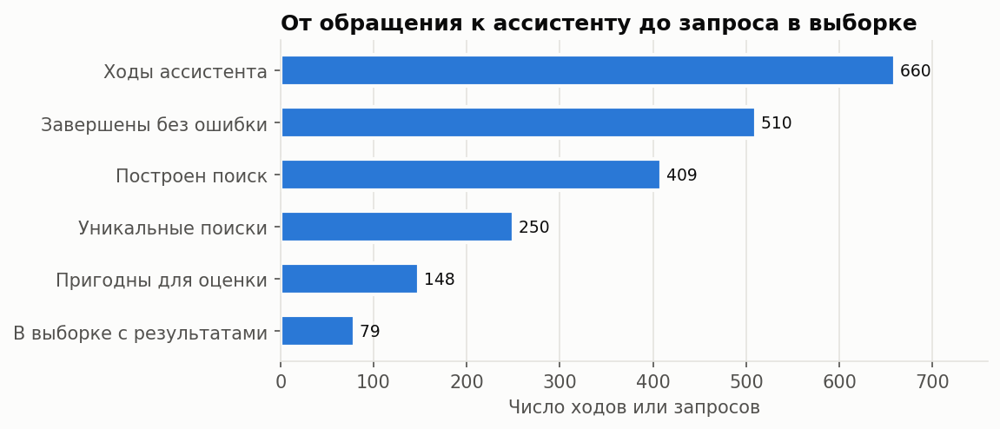
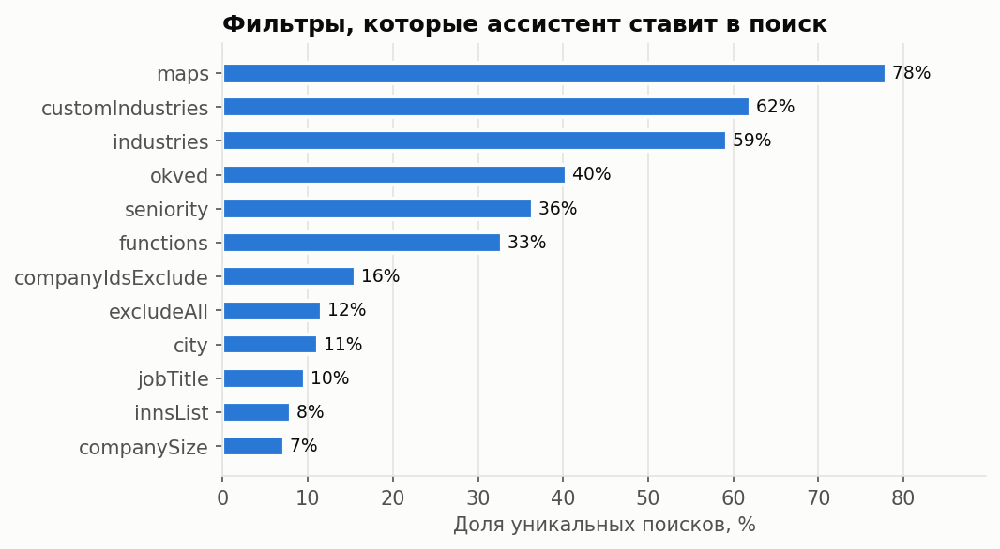
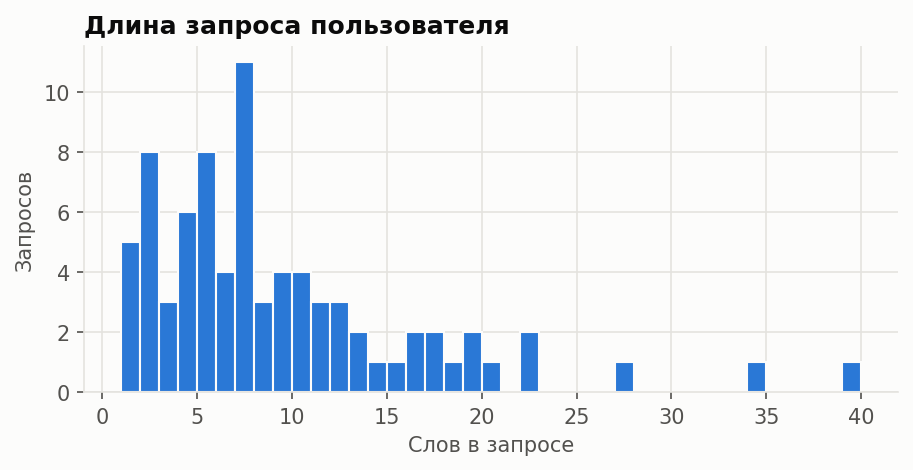
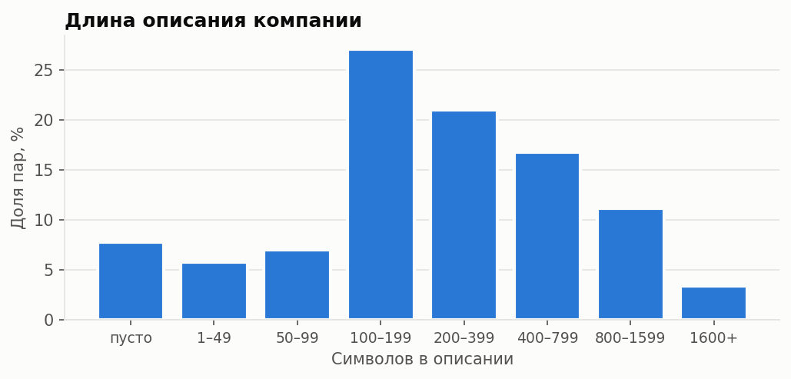
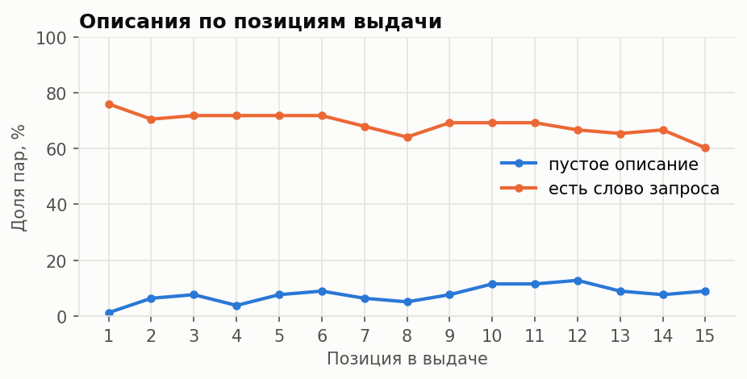
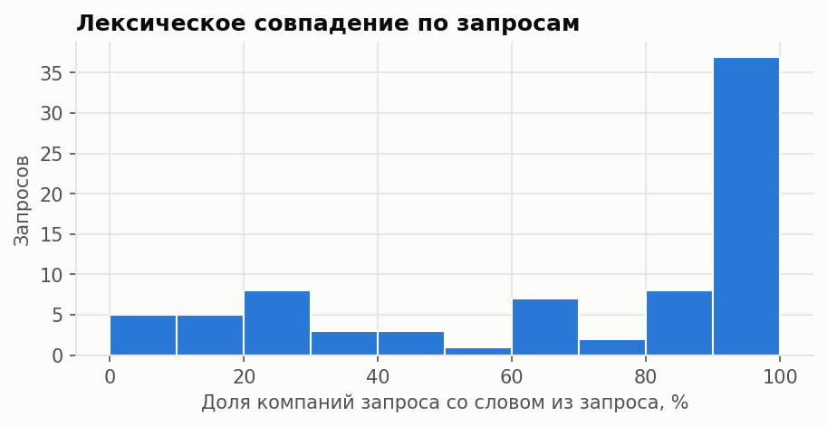
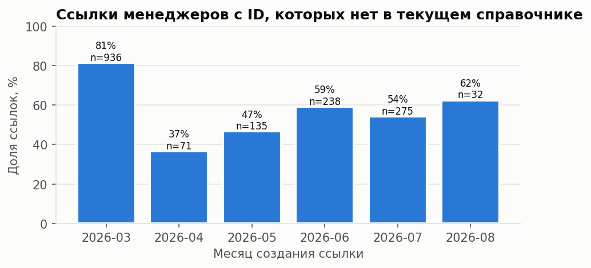

# EDA: запросы и выдача DealRocket

Снимок выдачи — 4 ноября 2026 года. Исходные строки хранятся локально в `data/raw/`
и не публикуются; здесь приведены только агрегаты. Цифры воспроизводятся командой
`python scripts/eda.py --excel <книга запросов>` и сохраняются в
[`eda_summary.json`](eda_summary.json).

## Источники

| Источник | Что содержит | Объём |
| --- | --- | --- |
| История диалогов ассистента (админка DealRocket) | Запрос пользователя, сценарий, статус хода, длительность, ссылка на построенный поиск | 451 диалог, 660 ходов, 15.09–02.11.2026 |
| Выдача `getResultsV2` по ссылкам ассистента | Первые 15 компаний поиска: ID, название, описание, отрасли, город, сайт, источники карточки | 79 запросов, 1171 пара, 1081 компания |
| Книга запросов менеджеров (Wazzup) | Ссылки менеджеров на выборки и их подписи, март–август 2026 | 1945 ссылок |
| Справочник фильтров `getFilters` | Текущие названия ID отраслей, ОКВЭД, рубрик карт | Снимок на дату выгрузки |

Книга менеджеров используется только для проверки устаревания ссылок: её подписи
часто не являются запросом («возвращаюсь с примером поиска») и содержат
персональные данные клиентов.

## Отбор запросов

Из 409 ходов с построенным поиском уникальных ссылок 250. Исключены 25 поисков
по готовым спискам компаний (ИНН, домены, ID): в них релевантность задана списком,
а не текстом. Ещё 13 поисков не содержат признаков компании, только должности
и уровни. В 17 ссылках есть ID, которых уже нет в текущем справочнике, хотя
ссылкам меньше двух месяцев. После удаления повторов одного и того же текста
запроса осталось 148 кандидатов; 80 выбраны случайно (seed = 42).

Один выбранный поиск вернул 0 компаний, ещё один — одну. 73 поиска из 80
упираются в лимит API в 300 компаний: выдача шире, чем видит пользователь,
и отбор действительно нужен.

## Запросы

Ассистент строит поиск в основном по отраслевым справочникам: рубрики карт — 78%
поисков, пользовательские отрасли — 62%, отрасли DealRocket — 59%, ОКВЭД — 40%.
Ключевые слова есть только в 2,8% поисков. Выдача описывается категориями,
а не формулировкой пользователя, поэтому проверка по тексту описания добавляет
новую информацию. В 16% поисков ассистент исключает отдельные компании
(`companyIdsExclude`); причина исключения в ссылке не сохраняется.

Медиана — 7 слов, 90% запросов короче 19 слов. Короткие запросы («Литейное
производство», «Автопарки») не задают явных критериев, длинные содержат сразу
отрасль, географию, размер и должности. В 49% запросов есть должность или роль:
она относится к поиску сотрудников и не проверяется по описанию компании.
13 из 79 запросов уточняют предыдущий ход диалога, и в шести из них
уточнение целиком меняет тему: «Автопарки» → «пищевые производства»,
«медицинские центры» → «онлайн-школы». Критерии берутся по последнему уточнению,
а не по всей истории диалога.

## Описания компаний

Описание пусто у 7,8% пар, короче 50 символов — ещё у 5,8%. Медиана непустого
описания — 233 символа, 95-й перцентиль — 1369. Ожидаемая доля
`insufficient_data` из-за пустых текстов — не меньше 7,8%. Это ниже порога 50%
из раздела 1.4 дизайн-документа, поэтому текстовая постановка задачи сохраняется.
Остальные источники карточки (медиана — 4 на компанию) эту проблему не решают:
у пустых описаний текст в них есть только в 1,1% случаев.

Другие свойства текста:

- в 17,2% описаний есть телефон или email, в 8,4% — ссылки;
- организационно-правовая форма (ООО, АО, ИП) есть в 11,6% названий; у таких
  карточек описание пусто в 41,2% случаев против 3,4% у остальных, и на них
  приходится 61,5% всех пустых описаний;
- у 1% пар внутри запроса повторяется название компании: это разные карточки
  с одинаковым названием;
- украинские буквы встречаются в 0,3% текстов; русскоязычная постановка корректна.

Доля пустых описаний не растёт монотонно с позицией: от 1% на первой позиции
до 13% на двенадцатой. Совпадение слов запроса снижается с 76% до 60%.
Позиция в выдаче не заменяет оценку релевантности.

## Сложность задачи

В 69% пар название или описание содержит хотя бы одно слово запроса
(сравнение по первым пяти буквам, без стоп-слов). Распределение по запросам
двугорбое: в 37 запросах совпадение есть почти у всех компаний, в 24 — меньше
чем у половины. Ручной просмотр показывает, что совпадение слов не означает
релевантности и наоборот:

- «Автопарки» — в выдаче таксопарки и автобусные парки, слова запроса не совпадают;
- «строительство дорог» — рядом с дорожными подрядчиками ремонт техники и продажа песка;
- «сетевые компании от 5 объектов» — поиск понял запрос как связь и вернул провайдеров.

Лексическое сходство не разделяет подходящие и неподходящие компании.
Это обосновывает сравнение бейзлайна с LLM, которая сопоставляет смысл;
результат сравнения даст разметка. Последний пример — ошибка построения поиска:
при разметке такие пары получают `irrelevant` и остаются в наборе.

## Пересечения компаний

67 компаний встречаются в двух и более запросах, это 157 пар из 1171.
Чаще всего пересекаются близкие запросы: «Литейное производство»
и «директора по продажам в компаниях литейного производства» — 9 общих компаний,
три разных запроса о загородном строительстве и застройщиках — по 11–14.
Встречаются и случайные пересечения далёких запросов, например производителей
косметики и загородного строительства — 4 компании. При разбиении на фолды
и test запросы с общими компаниями объединяются в одну группу: 79 запросов
образуют 50 групп, 41 запрос ни с кем не пересекается, крупнейшая группа —
14 запросов.

## Текущий ассистент

Из 660 ходов 20% завершились ошибкой; основные коды — `query_preparation_failed` (40),
`query_unknown_effect` (34), `provider_invalid_response` (14). Медианное время
хода — 55 секунд, 95-й перцентиль — 21 минута. Поле `aiAssessment`
в выдаче пусто у всех 1171 пары: ответы действующего AI-фильтра выгрузкой
не получены, сравнение с ним остаётся за рамками MVP.

## Устаревание ссылок

В 68,8% ссылок менеджеров с ID-фильтрами есть ID, которых нет в текущем справочнике.
Сохранившиеся ID тоже меняют смысл: отрасль из ссылки «маркетинговые агентства»
сейчас называется «вымышленный персонаж». Ссылка не фиксирует выдачу:
для эксперимента сохраняется снимок компаний, а не только ссылка поиска.

## Выводы для проекта

1. Данные пригодны для постановки: 79 запросов на естественном языке
   и 1171 пара с позициями и датой снимка. До плановых 1200 пар не хватает
   двух полных запросов; они добираются из оставшихся 68 кандидатов.
2. Класс `insufficient_data` подтверждён данными: пустые и короткие описания —
   13,6% пар, больше всего их у карточек юрлиц из реестра.
3. Критерии запроса нужно готовить вручную: половина запросов смешивает
   профиль компании и должность.
4. Разбиение — по группам запросов с общими компаниями.
5. Перед передачей во внешнюю LLM и публикацией примеров из описаний удаляются
   телефоны, email и ссылки.
6. Эталонные метки отсутствуют; распределение классов будет известно
   только после разметки.
